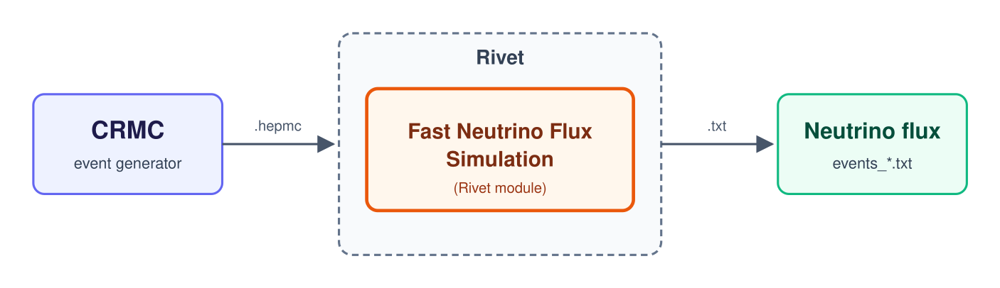

# Neutrino Flux with FastSim by F. Kling

## Introduction

The **Fast Neutrino Flux Simulation** developed by F. Kling and M. Fieg
([arXiv:2105.08270](https://arxiv.org/abs/2105.08270),
[arXiv:2402.13318](https://arxiv.org/abs/2402.13318)) is used to predict the forward neutrino
flux at SND@LHC. It runs fast, so the flux can be produced for different event generators and
LHC setups, and compared with the FLUKA neutrino flux used by SND@LHC.

The simulation workflow consists of two main steps. First, CRMC generates proton-proton
collisions and stores the produced particles in HepMC3 format. Then, Rivet processes these
events using the Fast Neutrino Flux Simulation module. The module propagates forward hadrons
through the LHC beam pipe and magnetic fields and simulates their decays into neutrinos.
Neutrinos crossing a scoring plane at 480 m from the collision point are saved in text files
for further analysis.

<p align="center">
  <br>
  <em><b>Figure 1.</b> Workflow of the simulation.</em>
</p>

## Installation

Install in the order below, because CRMC needs the HepMC3 library that comes with Rivet.
`$RIVET_DIR` and `$CRMC_DIR` are the installation folders, and `$FNFS_DIR` is the folder of the Fast Neutrino Flux
Simulation. Do not forget to `export` them to corresponding directories.

> **Prerequisites:** if you work on lxplus, you can ignore the "prerequisites" sections in
> the instructions of every program. Compilers, CMake, Boost and Python are already installed.

### Rivet

Rivet is a toolkit for analysing Monte Carlo collision events. Here, it runs the Fast Neutrino Flux Simulation modules on the events from CRMC.

Install Rivet following the instructions on its [website](https://heprivet.org/tutorials/installation/). This guide uses version 4.1.4, but the latest version is recommended. After installation, set up the environment in every new terminal before using Rivet or CRMC:

```bash
source $RIVET_DIR/rivetenv.sh
```

The installation also provides HepMC3, YODA and FastJet.

### CRMC

CRMC (Cosmic Ray Monte Carlo) is an interface to hadronic interaction models such as EPOS-LHC and SIBYLL. Here, it generates the proton-proton collisions.

Install CRMC following the instructions on its [GitLab](https://gitlab.iap.kit.edu/AirShowerPhysics/crmc). This guide uses version 2.2.1, but the latest version is recommended. Set up the Rivet environment before running `cmake`, so that CRMC finds HepMC3. Only EPOS-LHC is compiled by default. Other models are turned on at the `cmake` step, for example `-DCRMC_SIBYLL=ON`.

### Fast Neutrino Flux Simulation

The Fast Neutrino Flux Simulation is a set of Rivet modules that produce the neutrinos from the hadrons in each collision event and keep those crossing the scoring plane.

Download the code from its [GitHub](https://github.com/KlingFelix/FastNeutrinoFluxSimulation):

```bash
git clone https://github.com/KlingFelix/FastNeutrinoFluxSimulation.git $FNFS_DIR
```

The modules are in `RIVET_Modules/`, with one folder per LHC setup (`Rivet_Run3_MCFiles` for
Run 3). Each folder has one module per neutrino source:

* `*_Neutrinos_Light`: neutrinos from π, K and hyperon decays. Hadrons are propagated through the beam pipe and magnets and decayed along their trajectories, with rare decay channels oversampled and corrected by weights. A fixed number of events is then drawn with replacement, with probability proportional to the weights (weighted resampling), so the output is unweighted. For leading-order generators, e.g. EPOS-LHC and DPMJET-III.

* `*_Neutrinos_Charm`: neutrinos from charm hadron decays. Charm hadrons decay at the interaction point, each decay channel is sampled many times, and the resampling is biased toward high neutrino energies (weight ∝ E) to populate the high-energy tail. The bias is divided out in the output weights, so the output is unweighted. For leading-order generators.

* `*_Neutrinos_Charm_weighted`: same neutrino production as `*_Neutrinos_Charm`, but without resampling; every neutrino is written with its own weight. Designed for NLO generators such as POWHEG, where negative event weights prevent resampling.


> **Note on random numbers.**  The Rivet modules seed `rand()` automatically from the system time (1-second resolution), so no manual seed setting is needed.

#### Rivet 4 macros

The FastNeutrinoFluxSimulation modules were originally written for Rivet 3. If you use Rivet 4,
replace the following macros in each `*.cc` file before compiling:

```cpp
DEFAULT_RIVET_ANALYSIS_CTOR(X);
DECLARE_RIVET_PLUGIN(X);
```

with:

```cpp
RIVET_DEFAULT_ANALYSIS_CTOR(X);
RIVET_DECLARE_PLUGIN(X);
```

where `X` is the name of the module, for example `Run3_Neutrinos_Light`.

#### Settings

The settings are defined in each `*.cc` file. Wrong values do not give an error, only a wrong flux, so check them before compiling:

* `_dim`: area at z = 480 m in which neutrinos are kept, given as `{xmin, xmax, ymin, ymax}` in meters. The default values differ between modules. To use the SND@LHC acceptance, set `_dim` to `{-0.46, -0.07, 0.15, 0.54}` (x from −46 to −7 cm, y from 15 to 54 cm). Alternatively, use a larger area, e.g. `{-1.2, 1.2, -1.2, 1.2}`, and apply the SND@LHC acceptance cut to `events_*.txt` in the next step.

* `_xing_urad_h`, `_xing_urad_v`: horizontal and vertical crossing angles at IP1 in µrad for the year being simulated (see table below).

* `nevent`(`*_Neutrinos_Light` and `*_Neutrinos_Charm` only): number of neutrinos in the output after resampling. In `*_Neutrinos_Charm`, `nevent` is for ν<sub>e</sub> and ν<sub>μ</sub> only, and ν<sub>τ</sub> are set separately by `t_nevent`.

For POWHEG samples, use `*_Neutrinos_Charm_weighted`, as advised by F. Kling. This module has no nevent: the number of output lines depends on the number of input events. 

| Period (pp) | Beam optics | IP1 crossing | `_xing_urad_h` | `_xing_urad_v` |
|---|---|---|---|---|
| 2022–2023 | Nominal | Downward vertical, −160 µrad | `0` | `-160` |
| 2024 | Reverse polarity | Upward vertical, +160 µrad | `0` | `+160` |
| 2025–2026 | Nominal | Horizontal, +160 → +120 µrad | `+160` | `0` |

In 2025–2026, the angle is reduced from +160 to +120 µrad during each fill. The module takes
one value, so use `+160`, which covers 85% of the integrated luminosity.

#### Compiling

```bash
source $RIVET_DIR/rivetenv.sh
cd $FNFS_DIR/RIVET_Modules/Rivet_Run3_MCFiles/Run3_Neutrinos_Light
rivet-build RivetRun3_Neutrinos_Light.so Run3_Neutrinos_Light.cc
```

Other modules are compiled in the same way inside their own folders.

> **Rivet runs the compiled `.so` file, so run `rivet-build` again after every change in a
> `.cc` file.** Otherwise Rivet keeps using the old settings.

## Running

The example below uses 200k pp collisions at √s = 13.6 TeV with EPOS-LHC, and the Run 3
light hadron module.

### Generating pp collisions with CRMC

```bash
source $RIVET_DIR/rivetenv.sh
$CRMC_DIR/bin/crmc -c $CRMC_DIR/etc/crmc.param -I 2212 -P -6800 -i 2212 -p 6800 -m 0 -o hepmc3 -n 200000
```

where:

* `-c` is the CRMC parameter file. Without it, CRMC looks for `crmc.param` in the current folder;
* `-i`, `-p` and `-I`, `-P` are the id and momentum in GeV of the two beams;
* `-m` is the model: `0` EPOS-LHC, `6` SIBYLL, `8` PHOJET, `12` DPMJET-III;
* `-o` is the output format;
* `-n` is the number of events.

It is also possible to set the random seed with `-s` and the output file name with `-f`.

The output is a file named `crmc_eposlhcr_<seed>_p_p_6800.hepmc`, with one block per event
listing all the particles. It takes about 40 GB per 1M events.

### Running the simulation with Rivet

```bash
source $RIVET_DIR/rivetenv.sh
export RIVET_ANALYSIS_PATH=$FNFS_DIR/RIVET_Modules/Rivet_Run3_MCFiles/Run3_Neutrinos_Light
rivet crmc_eposlhcr_<seed>_p_p_6800.hepmc -a Run3_Neutrinos_Light -o Rivet.yoda
```

where:

* `RIVET_ANALYSIS_PATH` is the folder with the compiled module;
* `-a` is the name of the module;
* `-o` is the name of the Rivet output file.

To test the setup quickly, add `-n 1000` to process only the first 1000 events. Output files
are written in the current folder, so use a separate folder for each run.

### Output

The neutrinos are saved in `events_light.txt` (`events_charm.txt` and
`events_charm_weighted.txt` for the charm modules), one per line:

* neutrino PDG ID (12 = ν<sub>e</sub>, 14 = ν<sub>μ</sub>, 16 = ν<sub>τ</sub>, negative = anti ν);
* parent hadron PDG ID;
* x and y position at z = 480 m, in m;
* production z position, in m;
* x and y angle, in rad;
* energy, in GeV;
* event weight, in pb.

`events_charm_weighted.txt` has the event number as a 10th column. The first lines of
`events_light.txt` from a test run with 10k pp collisions:

```
-14  -211   -0.1948    0.2483 24.8400 -4.2289e-04 5.5168e-04 1.2957e+02 2.7486e+02
 14   211    0.2540    0.1192 14.5990 5.7059e-04 2.1518e-04 1.7028e+01 2.7486e+02
-14  -321    1.0136    0.4413 11.0990 2.1267e-03 9.2695e-04 1.6191e+02 2.7486e+02
```

`Rivet.yoda` only holds the event count and the cross section.

### Running on HTCondor

Large samples can be run in the same way as batch jobs: put the commands above in a script,
give each job its own seed (`-s`) and file name (`-f`), and submit it with `condor_submit`.

-- Main.ChayanitAsawatangtrakuldee - 2026-11-02
